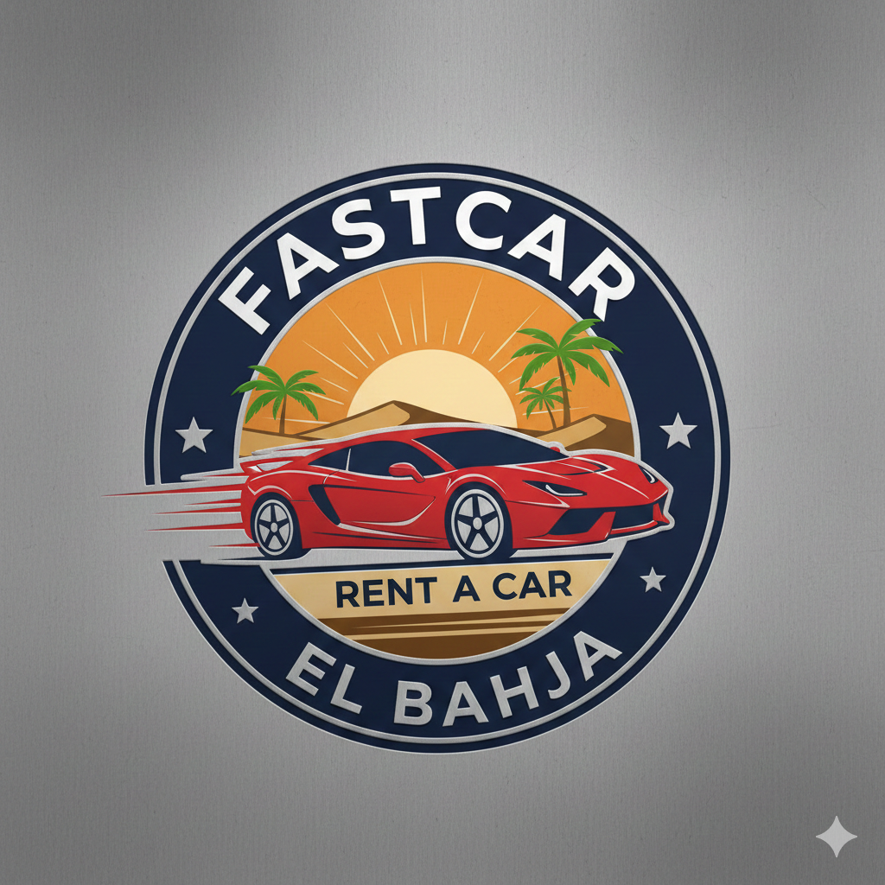
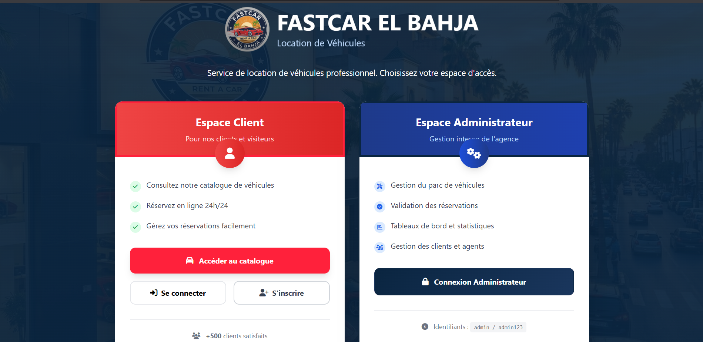
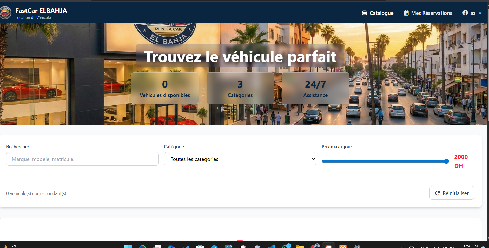
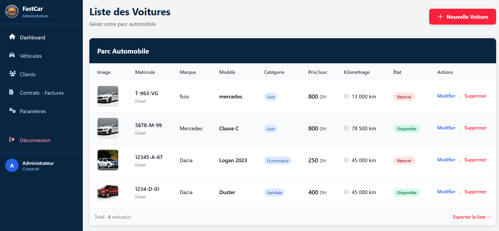
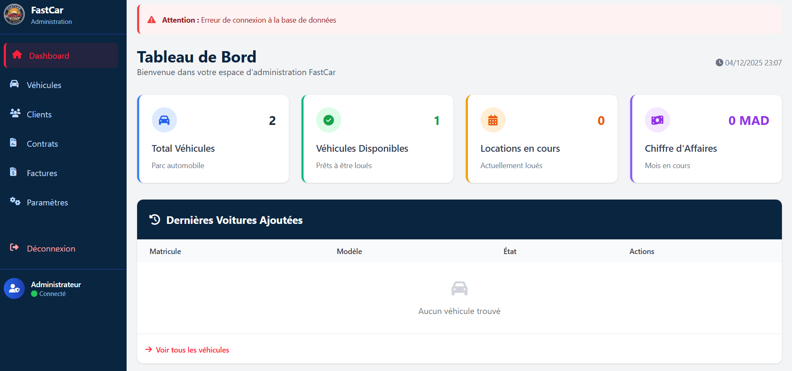

# 🚗 FASTCAR — Car Rental Management System

<p align="center">
  
</p>

<p align="center">
  A web application for managing a car rental agency (FastCar EL Bahja).
</p>

<p align="center">
  <b>React · TypeScript · Vite · Tailwind CSS · PHP · MySQL</b>
</p>

---

## 📌 Project Overview

FASTCAR is a web application designed to simplify and centralize the management of a car rental agency. It organizes vehicle, customer, staff, and rental contract information in one place.

The project applies Information Systems Engineering concepts through the **Merise methodology**, together with dynamic web development using **PHP and MySQL**.

## 🎯 Project Objectives

- Analyze the agency's needs and business rules.
- Build the conceptual and logical data models (MCD, MLD).
- Implement a robust relational database.
- Centralize vehicle and customer information.
- Manage staff and rental contracts.
- Track vehicle availability and condition in real time.
- Generate invoices automatically.
- Provide a clear and user-friendly interface.

## 📸 Application Screenshots

### 1. Login Page and Access Portal

The login page provides users with access to the application's available features.

<p align="center">
  
</p>

### 2. Administrator Dashboard

The dashboard provides an overview of management information and access to administrative features.

<p align="center">
  
</p>

### 3. Car Management

This interface displays the vehicles available in the application and allows users to browse the car list.

<p align="center">
  
</p>

### 4. Management Interface

<p align="center">
  
</p>

## ✨ Main Features

### 4.1. Home Page and Access Portal

- Application homepage.
- User login interface with Admin / Client sessions.
- Navigation to the available user areas.

### 4.2. Administrator Area

- Access to management information.
- Vehicle and related data management.
- Customer and agent information management.
- Contract creation and follow-up.

### 4.3. Customer Area

- Browse available rental vehicles.
- View relevant vehicle information.
- Access the rental workflow.

### 4.4. Billing Module

- Organize rental contract information.
- Track rental periods and amounts.
- Automatic invoice generation.

### 4.5. Technical Environment and Tools

| Category | Technology |
|---|---|
| Local server | XAMPP |
| Database | MySQL, administered with phpMyAdmin |
| Back-end | PHP (form handling, database connection, Admin/Client sessions) |
| Front-end | React, TypeScript, Vite |
| Markup and style | HTML5, Tailwind CSS (modern, responsive interfaces) |
| Interactions | JavaScript (animations, real-time field validation, search filters without reloading) |
| Tooling | Node.js, npm, Git and GitHub |

## 🗄️ Database Design (Merise)

### Main Entities

| Entity | Attributes |
|---|---|
| **Contract** | **NumContrat** (PK), DateDebut, DateFin, MontantTotal, ModePaiement |
| **Agent** | **NumAg** (PK), NomAg, PrenomAg |
| **Customer** | **CIN** (PK), NomClient, PrenomClient, AdresseComplete, Telephone, Email |
| **Vehicle** | **Matricule** (PK), Marque, Modele, EtatdeVehicule, Kilometrage |

### Relationships and Cardinalities

| Relationship | Entities | Cardinalities |
|---|---|---|
| **Gérer** | Contract — Agent | Contract (1,1) · Agent (1,N) |
| **Concerner** | Contract — Vehicle | Contract (1,1) · Vehicle (0,N) |
| **Signer** | Contract — Customer | A contract is signed by one customer |

In short:

- An agent can manage multiple rental contracts.
- A customer can sign multiple rental contracts.
- A vehicle can be associated with multiple contracts over time.

## 🚀 Getting Started

### Prerequisites

- Node.js and npm
- XAMPP (Apache and MySQL)
- Git

### Installation

Clone the repository:

```bash
git clone https://github.com/samidos03/FASTCAR.git
cd FASTCAR
```

Install dependencies:

```bash
npm install
```

Set up the database:

1. Start **Apache** and **MySQL** in XAMPP.
2. Open phpMyAdmin at `http://localhost/phpmyadmin`.
3. Create a database (for example `fastcar`).
4. Import the SQL file from the `backend` folder.

Start the development server:

```bash
npm run dev
```

Build for production:

```bash
npm run build
```

## 📁 Project Structure

```text
FASTCAR/
├── assets/
├── backend/
├── components/
├── services/
├── App.tsx
├── index.tsx
├── index.html
├── package.json
├── package-lock.json
├── tsconfig.json
├── vite.config.ts
├── metadata.json
├── logo.png
├── page_login.png
├── dashbord.png
├── listOfCars.png
├── bord.png
└── README.md
```

## 👨‍💻 Author

**Oussama Samid**

University Project — Information Systems

GitHub: [@samidos03](https://github.com/samidos03)

---

<p align="center">
  🚗 FASTCAR — Simplifying Car Rental Management.
</p>
